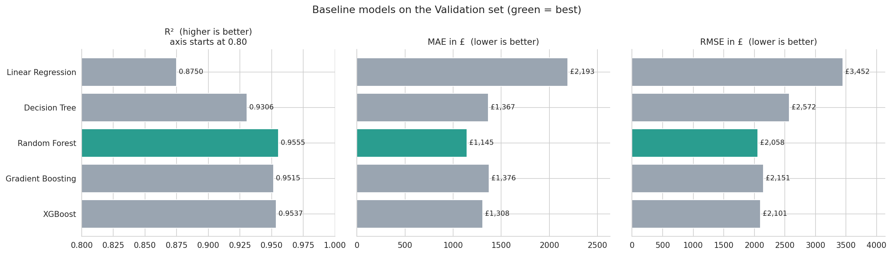
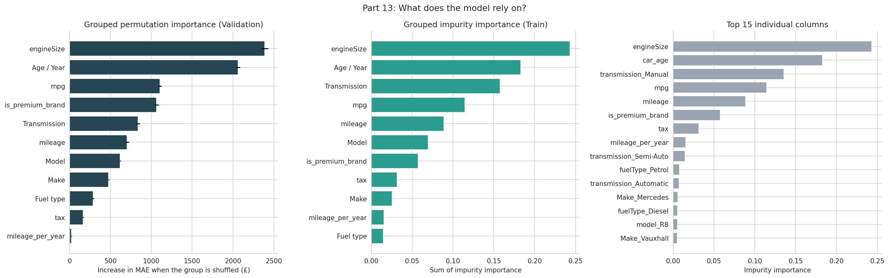

# AutoWorth AI — Used-Car Price Prediction & Deal Advisor

**Live demo:** https://autoworthai-hy2xhgsfunvewy7kwmbhdw.streamlit.app/  
**Source code:** https://github.com/ALII0101/AutoWorth_AI  
**Project report:** [`AutoWorth_AI/AutoWorth-AI-Used-Car-Price-and-Deal-Advisor.pdf`](AutoWorth_AI/AutoWorth-AI-Used-Car-Price-and-Deal-Advisor.pdf)

AutoWorth AI estimates the market price of a used car in the UK and compares a seller's asking price with that estimate. It combines a supervised regression model with a rule-based deal-rating layer and a Streamlit interface.

> This is an educational machine-learning project and a screening aid, not a vehicle inspection or a guaranteed valuation.

## What the app does

The user enters a car's make, model, model year, mileage, transmission, fuel type, engine size, and the seller's asking price. MPG and annual vehicle tax are optional. The app returns:

- An estimated market price in GBP.
- The seller's asking price and the difference from the estimate.
- A deal rating based on the asking price relative to the model estimate.
- Reliability notes when the input is unusual, the model is extrapolating beyond common training examples, or optional values have been imputed.

### Deal-rating rule

The percentage difference is calculated as:

`(estimated market price - seller's asking price) / estimated market price × 100`

The percentage is rounded to one decimal place before the rating is assigned.

| Rounded difference | Rating |
|---|---|
| More than 10% below estimate | Great Deal |
| 5% to 10% below estimate | Good Deal |
| More than 5% below and less than 5% above estimate | Fair Price |
| 5% to 10% above estimate | Slightly Overpriced |
| More than 10% above estimate | Overpriced |

The rating compares price only. It does **not** assess the vehicle's physical condition, accident history, service record, location, trim, or optional equipment.

## Dataset

The project report identifies the source as the **UK Used Car Dataset (Kaggle)**. The original combined data contains **99,187 listings** from nine manufacturers:

- Audi
- BMW
- Ford
- Hyundai
- Mercedes-Benz
- Skoda
- Toyota
- Vauxhall
- Volkswagen

After the documented cleaning stage, **97,677 rows** remain. The cleaned model-year range is **1996–2020**.

The data is historical listing data; the model is not trained on current live listings. Only make/model combinations represented in the training data are supported.

## Methodology

The workflow is organized into data integration and verification, cleaning, exploratory data analysis, splitting, feature engineering, preprocessing, model comparison, overfitting checks, hyperparameter tuning, final model selection, and the deal-advisor application.

### Data preparation

- Combined the nine manufacturer files and standardized the Hyundai tax-column name.
- Investigated duplicates and implausible records; the cleaning stage reduced the data from 99,187 to 97,677 rows.
- Split the cleaned data into **70% training (68,373 rows), 15% validation (14,652 rows), and 15% test (14,652 rows)**.
- Engineered three features: `car_age` (2020 minus model year), `mileage_per_year`, and `is_premium_brand` (Audi, BMW, and Mercedes-Benz).
- Fitted preprocessing on the training split only. Continuous values use median imputation and standardization; categorical values use one-hot encoding with unknown categories ignored; the binary feature passes through unchanged.
- The final preprocessed feature matrix contains **215 columns**. The target `price` is excluded from the input features.

### Model comparison

Five regression models were compared on the validation set:

| Model | Validation R² | Validation MAE | Validation RMSE |
|---|---:|---:|---:|
| Linear Regression | 0.8750 | £2,193 | £3,452 |
| Decision Tree | 0.9306 | £1,367 | £2,573 |
| Random Forest | **0.9555** | **£1,145** | **£2,059** |
| Gradient Boosting | 0.9515 | £1,376 | £2,151 |
| XGBoost | 0.9537 | £1,308 | £2,101 |

Random Forest was selected as the final model. A RandomizedSearchCV tuning exercise produced only a small validation improvement; the project retained the baseline Random Forest after treating the baseline and tuned candidates as effectively tied under the predefined selection rule and preferring the smaller model with the smaller generalization gap.

### Final test-set results

The held-out test set was used for the final evaluation, not for fitting the preprocessing steps or selecting features.

| Metric | Test result |
|---|---:|
| R² | **0.9596** |
| MAE | **£1,156** |
| RMSE | **£2,008** |
| Median absolute percentage error | **5.35%** |
| Predictions within ±10% of actual price | **76.7%** |

R² is a regression metric; it is **not** classification accuracy or a claim that 95.96% of predictions are exactly correct.

An experimental neural-network comparison is also included in the project materials. It was evaluated on the validation split and was not selected as the deployed model; Random Forest remained the final model.

### Project visualizations

**Validation model comparison**



**Random Forest feature importance**



## Limitations

- The dataset ends at model year **2020**. The app rejects newer model years.
- Only make/model combinations seen in the training data can be valued.
- Vehicle condition, accident history, service history, location, trim, and optional extras are not included in the dataset.
- Errors are larger for cheaper cars (below £5,000), expensive cars (at or above £40,000), and rare make/model combinations.
- MPG and tax can be omitted; the advisor fills missing values using medians from similar training cars where possible and reports the imputation.
- The deal rating is a price-comparison signal only. A low asking price may reflect vehicle damage or other factors the model cannot observe.

Use the estimate as an initial screening signal and independently inspect the vehicle and its history before making a purchase decision.

## Run the Streamlit app locally

The deployed app files are currently in `AutoWorth_AI/stremlit/` (the directory name is retained as it exists in this repository).

1. Clone the repository and retrieve the Git LFS model file:

   ```bash
   git clone https://github.com/ALII0101/AutoWorth_AI.git
   cd AutoWorth_AI
   git lfs install
   git lfs pull
   ```

2. Create and activate a virtual environment, then install the app requirements:

   ```bash
   cd AutoWorth_AI/stremlit
   python -m venv .venv
   # Windows PowerShell:
   .venv\Scripts\Activate.ps1
   # macOS / Linux:
   # source .venv/bin/activate
   python -m pip install -r requirements.txt
   ```

3. Start the app:

   ```bash
   streamlit run app.py
   ```

The saved Random Forest artifact is tracked with **Git LFS**. A regular source ZIP may contain only the small LFS pointer file rather than the 122.8 MB model artifact; use `git lfs pull` after cloning before running the app locally.

## Run the application checks

From `AutoWorth_AI/stremlit/`, after installing dependencies and retrieving the model artifact:

```bash
python test_advisor.py
```

The included checks cover model/preprocessor loading and version compatibility, training-prediction parity, one-car feature-building parity, deal-rating boundaries, invalid inputs, and basic behaviour checks.

## Repository layout

```text
.
├── AutoWorth_AI/
│   ├── data/                 # source/cleaned data, splits, metrics, plots, saved artifacts
│   ├── fix 2/                # staged analysis, feature engineering, model and evaluation scripts
│   ├── stremlit/             # Streamlit app, advisor logic, app data and deployment artifacts
│   ├── project1.py           # initial data loading, integration and inspection
│   └── AutoWorth-AI-Used-Car-Price-and-Deal-Advisor.pdf
└── runtime.txt
```

The training/analysis scripts are retained as the project workflow. The `stremlit/requirements.txt` file is for the deployed application; it is not a complete environment specification for every exploratory and training script.

## Dataset and artifact note

The project report names Kaggle as the dataset source. Check the original dataset's terms and license before redistributing the raw CSV files. The trained model is stored with Git LFS.
